# seg2med

[](https://huggingface.co/spaces/Zeyu0601/seg2med-demo)

**Segmentation-guided CT/MR image synthesis with physics-informed image priors.**


Starting from a CT or MR volume, seg2med creates organ/tissue segmentations,
simulates an image prior with PhysioSynth, and uses that prior to condition a
trained diffusion model. The simplest workflow has two commands:

```bash
python prepare_case.py --config configs/prepare_case.yaml
python -m seg2med_train.train --config configs/test_ddpm_mr256.yaml
```

Edit the input paths, device, and checkpoint settings below before running them.
Preparation accepts `.nii` and `.nii.gz` volumes. Inference requires a compatible
trained checkpoint; download the available 256×256 models linked below. Datasets
and checkpoint files are not bundled in this repository.

## Installation

Clone this repository and run commands from its root directory. The supplied
[environment.yaml](environment.yaml) specifies Python 3.10 and PyTorch 2.4.1
with CUDA 11.8:

```bash
conda env create -f environment.yaml
conda activate seg2med
python -m pip install yacs pandas matplotlib scikit-learn scikit-image nibabel SimpleITK imageio
python -c "import torch; print(torch.__version__); print('CUDA available:', torch.cuda.is_available())"
```

Use a CUDA/PyTorch installation compatible with your hardware. Preparation uses
TotalSegmentator; the selected tasks may require a license, and model weights may
be downloaded on first use. Configure any required license before running those
tasks. Existing masks can be reused without launching TotalSegmentator.

## Step 1 — Prepare masks and image priors

Edit [configs/prepare_case.yaml](configs/prepare_case.yaml). For example:

```yaml
overwrite_seg: false
overwrite_prior: false
segmentation:
  device: cuda:0 # cuda:1 selects the second visible GPU; cpu is also supported
  fast: false

case:
  - id: '1PA001'
    dataset: synthrad_mr_t1
    modality_name: mr_t1_gre
    img: /absolute/path/to/1PA001/mr.nii.gz
  - id: '1PA004'
    dataset: synthrad_mr_t1
    modality_name: mr_t1_gre
    img: /absolute/path/to/1PA004/mr.nii.gz
```

Replace the example paths with your own; Windows paths such as
`F:\data\1PA001\mr.nii.gz` also work. `dataset` names your source, `id` identifies
the case, and `modality_name` selects the simulation model. Cases run sequentially.
Top-level settings are shared; individual cases can override them. A flat YAML
containing one case is also supported.

```bash
# Optional: inspect planned work without writing files or running models.
python prepare_case.py --config configs/prepare_case.yaml --dry-run

# Generate missing outputs, or reuse existing ones.
python prepare_case.py --config configs/prepare_case.yaml
```

For each `mr.nii.gz`, the outputs are saved beside the input:

```text
1PA001/
├── mr.nii.gz                  # original image, never overwritten
├── mr_seg.nii.gz              # organ labels
├── mr_seg_tissue.nii.gz       # tissue labels
├── mr_prior_image.nii.gz      # simulated intensity prior
├── mr_prior_semantic.nii.gz   # semantic conditioning labels
├── mr_target.nii.gz           # body-contour-processed reference image
├── mr_contour.nii.gz          # body mask
├── mr_seg.csv                 # intermediate segmentation manifest
└── mr_priors.csv              # manifest for model input
```

Each case has its own CSVs. CT outputs use the same naming convention with the
input filename's stem. The prior CSV contains
`id,aorta_diss,prior,img,modality,prior_semantic`; `img` points to the processed
target, and `aorta_diss` remains `0` for compatibility. When reusing existing
priors without a processed target, `img` points to the original image instead.

Existing files are reused by default. Missing masks or priors are generated
individually. To regenerate outputs, set the YAML overwrite flags to `true`, or run:

```bash
python prepare_case.py --config configs/prepare_case.yaml --overwrite-seg --overwrite-prior
```

The overwrite flags are independent: regenerating masks does not automatically
refresh existing priors. Enable both when you want both stages refreshed.
Defaults live in [case_defaults.yaml](seg2med_workflow/case_defaults.yaml): CT uses
`total` / `tissue_types`, MR uses `total_mr` / `tissue_types_mr`, and both use
multilabel output with `fast: false`.

Direct CLI input remains single-case only:

```bash
python prepare_case.py --dataset my_mri --id case001 --img /path/to/mr.nii.gz --modality-name mr_t1_gre --device cuda:0
```

YAML-relative paths resolve from the YAML's directory; CLI paths resolve from the
working directory. Manifest paths are absolute by default. If you use
`--no-absolute-paths`, set inference `dataset.data_dir` to the prior CSV's directory
so its relative image paths can be resolved.

## Step 2 — Generate images with a trained model

### Pretrained checkpoints

- **256×256 CT, T1-weighted MR, and T2-weighted MR checkpoints — [Download on Hugging Face](https://huggingface.co/Zeyu0601/seg2med_model/tree/main)**. Downsampled models for fast inference.
- **512×512 CT, T1-weighted MR, and T2-weighted MR checkpoints — [Download on Hugging Face](https://huggingface.co/Zeyu0601/seg2med_model/tree/main)**. Downsampled models for better quality.

Download a checkpoint and set `ckpt_path` to its local path in the inference YAML.

Use [test_ddpm_mr256.yaml](configs/test_ddpm_mr256.yaml) for the MR example or
[test_ddpm_ct256.yaml](configs/test_ddpm_ct256.yaml) for the CT example.
The supplied YAMLs contain machine-specific paths and GPU indices: edit them
before running. In the existing test YAML, update at least these fields:

```yaml
mode: test
model_name: ddpm2d_seg2med
dataset_name: image_prior_csv
ckpt_path: /absolute/path/to/compatible_checkpoint.pt
GPU_ID: [0]

dataset:
  data_dir: /absolute/path/to/1PA001
  test_csv: /absolute/path/to/1PA001/mr_priors.csv
```

This block shows the fields to edit, **not a replacement for the full model
configuration**. Keep the network architecture, conditioning, normalization, and
preprocessing compatible with the checkpoint. The supplied 256-pixel examples
use `zoom: [0.5, 0.5, 1.0]` and `resized_size: [256, 256, null]`.
In `mode: test`, training and validation CSVs are not required.

```bash
python -m seg2med_train.train --config configs/test_ddpm_mr256.yaml
# For the CT configuration:
python -m seg2med_train.train --config configs/test_ddpm_ct256.yaml
```

Point `dataset.test_csv` at the case you want to process and rerun for another
case. For an existing multi-row prior manifest, the same runner processes all
listed rows. Use `dataset_name: semantic_prior_csv` only with a checkpoint trained
for semantic conditioning; it uses `prior_semantic` instead of `prior`.

Results appear beneath `logs/<run>/saved_outputs/epoch_<checkpoint_epoch>/`:

| Location | Contents |
| --- | --- |
| `img/` | Separate input, generated-output, and target TIFF volumes |
| `img/input/`, `img/output/`, `img/target/` | Optional incremental PNG slices |
| `npy/input/`, `npy/output/`, `npy/target/` | Optional incremental NPZ slices |
| `dicom/input/`, `dicom/output/`, `dicom/target/` | Optional DICOM series, beside `img/` |

Control optional exports in the inference YAML:

```yaml
validation:
  save_png: false
  save_npz: false
  save_dicom: false
```

TIFF volumes are always saved. Exports contain model-space image values; DICOM
exports are derived secondary-capture series, not reconstructed acquisition
metadata. Inspect preprocessing and output geometry for your research task.

## Additional Applications

## Modality Conversion for Image Priors
Using the segmentation files we can generate image priors of multiple modalities, which can be used to generate registrated multi-modal medical images

to be updated...

## Using Digital Phantoms for Image Priors

We can also get segmentation files from XCAT Digital Phantoms and create virtual image priors, then use them for generating images

to be updated...

## Available modalities

Use a name as `modality_name` in the preparation YAML, or its integer ID as
`modality`. Both select the same simulation and normalization settings.

| ID | Modality name | PhysioSynth model |
| --- | --- | --- |
| 0 | `ct` | Organ/tissue HU lookup |
| 1 | `mr_t1_gre` | T1-weighted gradient echo: `gre_t1` |
| 2 | `mr_t2_space` | T2-weighted approximation: `t2_space` |
| 3 | `mr_vibe_in` | VIBE in-phase: `vibe` |
| 4 | `mr_vibe_opp` | VIBE opposed-phase: `vibe_opposed` |
| 5 | `mr_vibe_dixon_tra_in` | Dixon TRA in-phase: `vibe_dixon_in` |
| 6 | `mr_vibe_dixon_tra_opp` | Dixon TRA opposed-phase: `vibe_dixon_opposed` |
| 7 | `mri_2d_grayscale` | Legacy grayscale-MRI entry; uses `gre_t1` for volume priors |

The preparation script expects 3D NIfTI volumes, including for modality 7.
The modality name does not verify the acquisition sequence automatically: select
the entry that matches your input and trained checkpoint.

## Physics models and research customization

MR signal equations are implemented in [formulas.py](seg2med_physiosynth/formulas.py).
They provide simplified, sequence-dependent intensity priors, not full
scanner/sequence simulations.

Gradient-echo-based sequences use:

$$
S_{\mathrm{GRE}} = \rho\sin\alpha\,
\frac{1-e^{-TR/T_1}}{1-\cos\alpha\,e^{-TR/T_1}}\,
e^{-TE/T_{2,\mathrm{eff}}}.
$$

The T2 SPACE approximation uses:

$$
S_{\mathrm{SPACE}} = \rho\,(1-e^{-TR/T_1})\,e^{-TE/T_2}.
$$

Dixon variants multiply the gradient-echo signal by a water/fat phase term:

$$
S_{\mathrm{Dixon}} = S_{\mathrm{GRE}}\,
\left|W + F e^{i2\pi\Delta f\,TE/1000}\right|.
$$

TE, TR, T1, and T2 are in milliseconds; `/1000` converts TE to seconds for the
Dixon frequency term. The current sequence constants are:

| Sequence | TE (ms) | TR (ms) | Flip angle (degrees) |
| --- | ---: | ---: | ---: |
| T1 GRE | 4.00 | 7.00 | 10 |
| T2 SPACE | 150.00 | 2000.00 | — |
| VIBE in-phase | 4.54 | 7.25 | 10 |
| VIBE opposed-phase | 2.30 | 7.25 | 10 |
| VIBE Dixon TRA in-phase | 2.30 | 4.60 | 10 |
| VIBE Dixon TRA opposed-phase | 1.15 | 4.60 | 10 |

Dixon uses `W = 0.9`, `F = 0.1`, and `Δf = 220 Hz`. Modality 7 reuses T1 GRE
constants. These values reflect the current code, including the distinct Dixon
echo times. The GRE function names its transverse-relaxation argument `t2_star`;
the simulator currently supplies the CSV's `T2` column to all MR formulas, so it
does not use a separate measured T2* parameter table.

Tissue/organ properties are stored in:

- [params_ct.csv](seg2med_physiosynth/params_ct.csv): label order, organ name, and HU value.
- [params_mr.csv](seg2med_physiosynth/params_mr.csv): label order, organ name, T1, T2, and proton-density parameter `Rho`.

To use your own tissue tables, preserve their column names and label-order
mapping, and supply paths in the preparation YAML:

```yaml
parameters:
  ct: /path/to/my_params_ct.csv
  mr: /path/to/my_params_mr.csv
prior:
  min_contour_area: 10000
  body_threshold: null # null keeps the modality-specific threshold
```

TE/TR/flip-angle constants are currently changed in `formulas.py`, not through
YAML. Prior and target normalization ranges are defined by `NormalizePriorTargetd`
in [Dataloader.py](seg2med_train/Dataloader.py): values are clipped to the selected
modality's range and scaled to `[0, 1]`. Semantic conditioning labels are not
intensity-normalized. Changing physics parameters or normalization changes the
model's input distribution; keep inference consistent with how your checkpoint
was trained, or retrain/fine-tune and validate the change.

## Gallery

Representative inference slices from [figures/](figures/). Columns show
**conditioning prior → generated image → reference target**. These qualitative
examples are not a quantitative performance evaluation.

| Example | Conditioning prior | Generated image | Reference target |
| --- | --- | --- | --- |
| CT · abdomen | 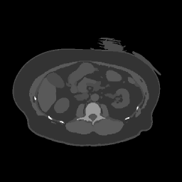 | 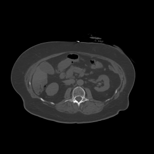 | 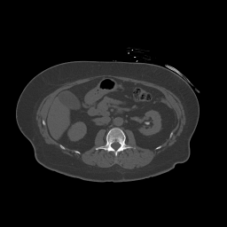 |
| CT · chest | 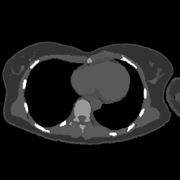 | 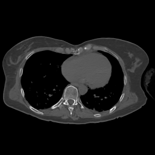 | 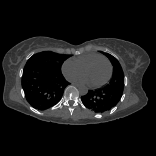 |
| CT · pelvis | 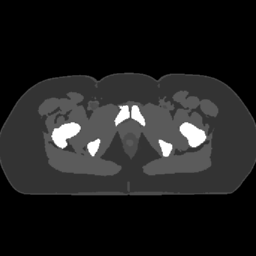 | 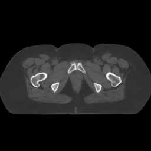 | 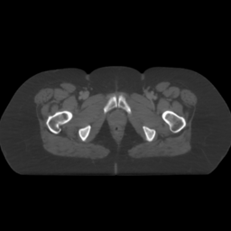 |
| MR · T1 GRE | 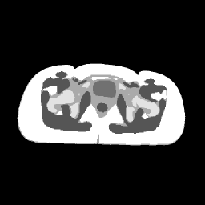 | 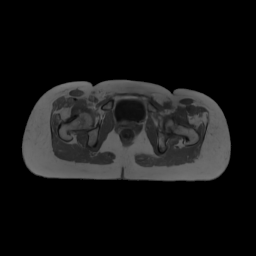 | 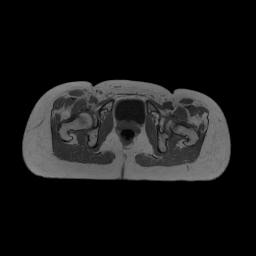 |
| MR · T2 SPACE | 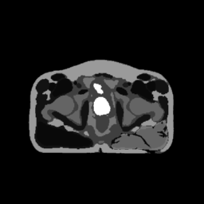 | 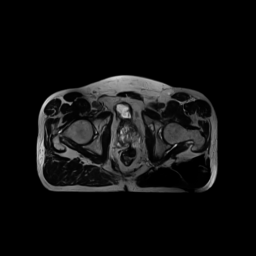 | 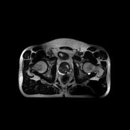 |

For research use. Confirm data-sharing permissions and anonymization before
redistributing images, manifests, or model checkpoints.

## License

Unless otherwise noted, original code in this repository is licensed under the
[MIT License](LICENSE). Third-party components retain their own licenses and
copyright notices, including those in individual subdirectories. Datasets and
model checkpoints may have separate terms; the code license does not override
those terms.

## Citation

Please cite the following paper and star this project if you use this repository
in your research. Thank you!

Zeyu Yang et al. **seg2med: a bridge from artificial anatomy to multimodal medical
images.** *Physics in Medicine & Biology*, 70(24), 245015 (2025).
[Read the paper](https://doi.org/10.1088/1361-6560/ae2738).

```bibtex
@article{Yang_2025,
  doi = {10.1088/1361-6560/ae2738},
  url = {https://doi.org/10.1088/1361-6560/ae2738},
  year = {2025},
  month = {dec},
  publisher = {IOP Publishing},
  volume = {70},
  number = {24},
  pages = {245015},
  author = {Yang, Zeyu and Chen, Zhilin and Sun, Yipeng and Strittmatter, Anika and Raj, Anish and Allababidi, Ahmad and Rink, Johann S and Zöllner, Frank G},
  title = {seg2med: a bridge from artificial anatomy to multimodal medical images},
  journal = {Physics in Medicine & Biology}
}
```
